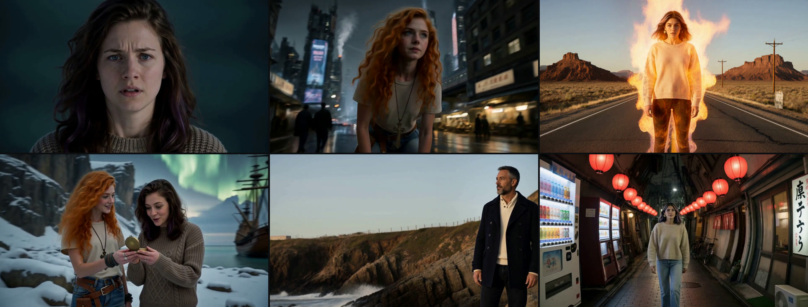
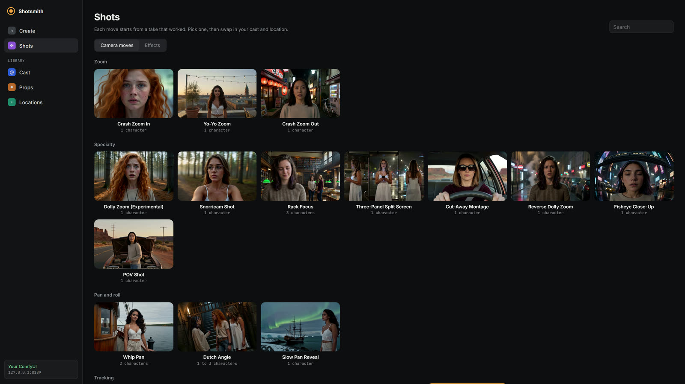
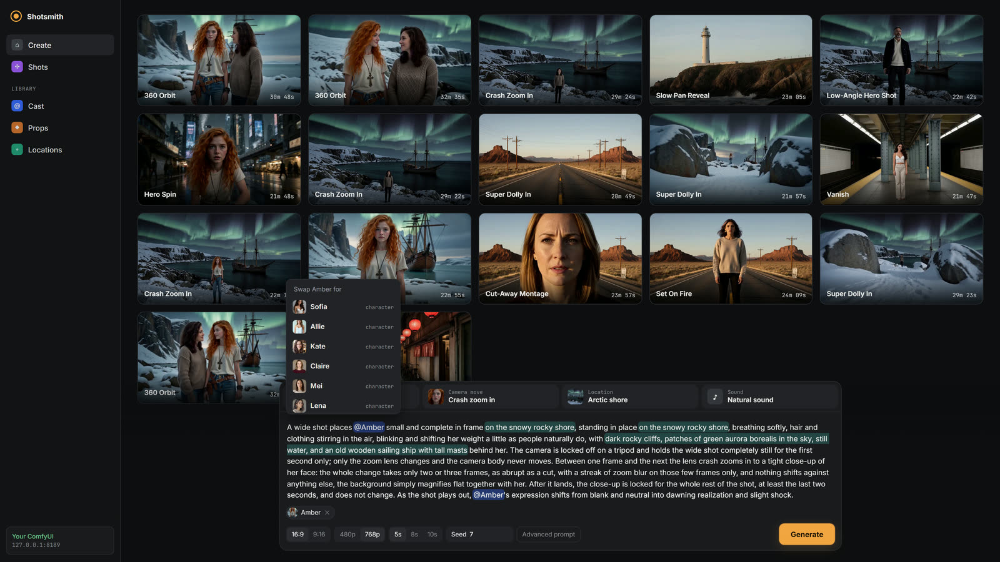
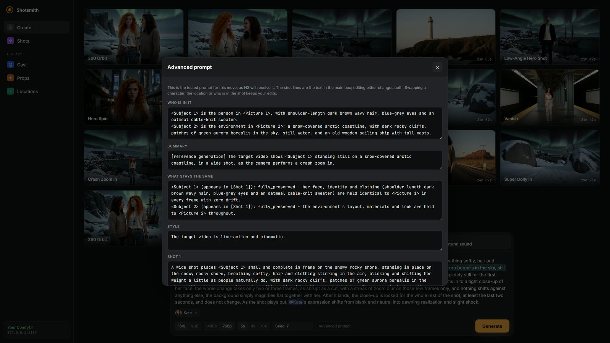
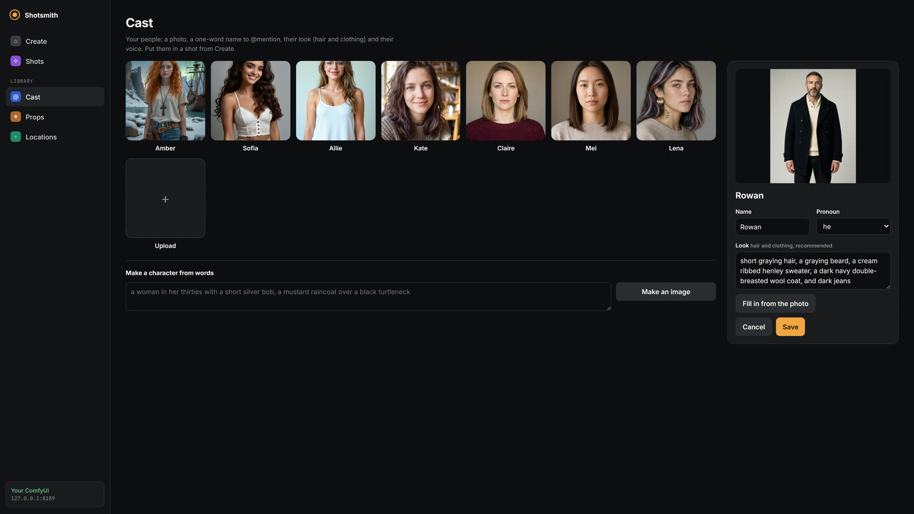
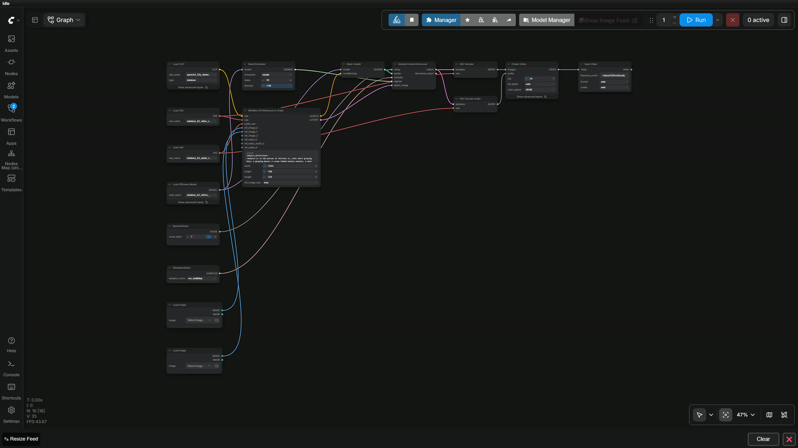
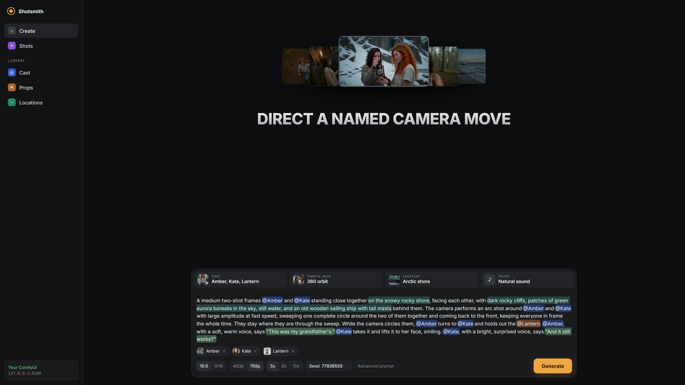
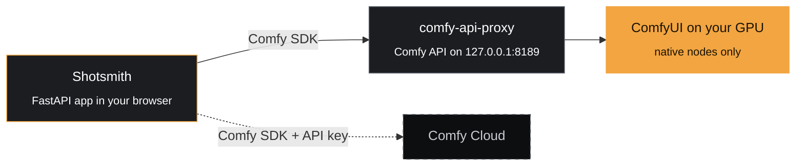

<div align="center">

# Shotsmith

**Camera-move and effect templates for MiniMax H3.**
Pick a shot that already works, swap in your own people, props and places, and render it on your own GPU through the Comfy SDK.

[](LICENSE)
[](https://github.com/comfyanonymous/ComfyUI)
[](https://huggingface.co/Comfy-Org/MiniMax-H3)
[](https://docs.comfy.org/development/api-development/sdks)
[](https://www.python.org/)
[](#how-it-works)



*Every frame above is a Shotsmith render, made on an RTX 3060.*

</div>

---

## Why it exists

MiniMax H3 is a strong video model with a hard prompt. Every render wants six sections, and every
person, prop and place is defined, tied to its picture, and described again in each one. A 360 orbit
of two people handing over a compass is **447 words** of prompt.

And H3 has no named shots. It knows twelve camera primitives (pan, tilt, zoom, arc and so on), so a
"dolly zoom" or a "crash zoom" has to be written as a sentence built from those, and most ways of
writing it do not work.

Shotsmith turns the ones that do work into templates:

| You write | H3 receives |
|---|---|
| `@Amber turns to @Kate and holds out the @Compass. @Amber says "This was my grandfather's."` | All six sections, every reference bound to its picture, the tested camera wording untouched, the dialogue in H3's speaker format |

Swap a person, a prop or a place with a click, and only their parts of the prompt change, in every
section. The camera wording that was tested stays word for word.

> [!TIP]
> Want to see everything H3 gets? **Advanced prompt** shows the whole prompt, and an edit there shows up in the shot text too. It is one prompt underneath.

## What you can do

<table>
<tr>
<td width="50%" valign="top">

### 🎬 Pick a move
**34 camera moves and 11 effects**, each one loaded from a take that worked: crash zoom, dolly
zoom, 360 orbit, hero spin, racing-drone dive, set on fire, vanish, architecture wave and more.

</td>
<td width="50%">



</td>
</tr>
<tr>
<td width="50%">



</td>
<td width="50%" valign="top">

### 🔁 Swap anyone, anything, anywhere
Click a character, a prop or the location and pick another. The app rewrites that person's name,
look and pronouns everywhere they appear, or the place's words, and nothing else.

</td>
</tr>
<tr>
<td width="50%" valign="top">

### ✍️ One sentence, or the whole prompt
The text box is the shot, with coloured tags for people, props and the place. Dialogue goes in
quotes. **Advanced prompt** opens every section H3 receives, and the two stay in sync.

</td>
<td width="50%">



</td>
</tr>
<tr>
<td width="50%">



</td>
<td width="50%" valign="top">

### 🧑‍🎨 Make your own cast and places
Upload a photo, or describe someone and click **Make an image** (Qwen Image 2.1). Then **Fill in
from the photo** has Qwen3-VL read the picture and write out their hair and every piece of clothing,
which H3 holds far better when the prompt names it. Places work the same way.

</td>
</tr>
<tr>
<td width="50%" valign="top">

### 🔍 Every render is reproducible
Each render keeps its prompt and its ComfyUI workflow. **Recreate** loads it back into the app,
and the workflow opens in ComfyUI as it ran: native nodes only.

</td>
<td width="50%">



</td>
</tr>
</table>

## Quick start

> [!NOTE]
> You need an NVIDIA GPU, **Python 3.12**, **git** and **ffmpeg** (the crash zooms use it). Shotsmith was built on an RTX 3060 12 GB with 32 GB of RAM. These steps were recorded end to end on a fresh Ubuntu 24.04 machine.

### 1 · ComfyUI

ComfyUI **0.41.0 or later**, which has the native MiniMax H3, Qwen Image 2.1, TextGenerate and
SaveText nodes. **No custom nodes.** Straight from
[ComfyUI's README](https://github.com/comfyanonymous/ComfyUI#manual-install-windows-linux):

```bash
git clone https://github.com/comfyanonymous/ComfyUI.git
cd ComfyUI
python3 -m venv venv
source venv/bin/activate            # Windows: venv\Scripts\activate
pip install torch torchvision torchaudio --extra-index-url https://download.pytorch.org/whl/cu130
pip install -r requirements.txt
cd ..
```

### 2 · The models (about 60 GB)

From the folder that holds ComfyUI:

```bash
pip install -U huggingface_hub
hf download Comfy-Org/MiniMax-H3 --local-dir ComfyUI/models \
  diffusion_models/minimax_h3_ref2va_pruned_int8_convrot.safetensors \
  text_encoders/qwen3vl_32b_minimax_h3_nvfp4_awq.safetensors \
  vae/minimax_h3_video_vae_fp16.safetensors vae/minimax_h3_audio_vae_fp32.safetensors
hf download Comfy-Org/Qwen-Image-2.1 --local-dir ComfyUI/models \
  diffusion_models/qwen_image_2.1_turbo_int8_convrot.safetensors \
  text_encoders/qwen3vl_8b_int8_convrot.safetensors vae/qwen_image_2.1_vae_bf16.safetensors
```

<details>
<summary>What each file is for</summary>

| Folder | File | Used for |
|---|---|---|
| `diffusion_models` | `minimax_h3_ref2va_pruned_int8_convrot.safetensors` | rendering |
| `text_encoders` | `qwen3vl_32b_minimax_h3_nvfp4_awq.safetensors` | rendering |
| `vae` | `minimax_h3_video_vae_fp16.safetensors`, `minimax_h3_audio_vae_fp32.safetensors` | rendering |
| `text_encoders` | `qwen3vl_8b_int8_convrot.safetensors` | **Fill in from the photo**, **Describe it from the image**, **Make an image** |
| `diffusion_models` | `qwen_image_2.1_turbo_int8_convrot.safetensors` | **Make an image** |
| `vae` | `qwen_image_2.1_vae_bf16.safetensors` | **Make an image** |

The first four are all a render needs. Without the Qwen files, rendering still works, and the
describe and Make image buttons say which file is missing.

Different file names for the H3 files? Put them in `shotstudio/models.json`:

```json
{"unet": "...", "clip": "...", "video_vae": "...", "audio_vae": "..."}
```

</details>

### 3 · Start ComfyUI, then Shotsmith

```bash
python ComfyUI/main.py --port 8188          # in its own terminal (or in the background)

git clone https://github.com/loopforge0/shotsmith.git
cd shotsmith
python3 -m venv .venv
.venv/bin/pip install -r requirements.txt   # Windows: .venv\Scripts\...
.venv/bin/comfy-api-proxy start --state-dir outputs/proxy-state
COMFY_BASE_URL=http://127.0.0.1:8189 .venv/bin/python -m shotstudio.server
```

Open **http://127.0.0.1:7860** and you are in.



> [!TIP]
> **On Windows**, once ComfyUI is running on port 8188, `run_local.bat` starts the proxy and the app.
> ComfyUI on another port: add `--comfyui http://127.0.0.1:PORT` to the proxy. The app on another port: set `PORT`.

<details>
<summary><b>☁️ Run it on Comfy Cloud instead</b></summary>

The same code talks to Comfy Cloud. Create an API key at [platform.comfy.org](https://platform.comfy.org)
(API access needs a paid Cloud plan), then:

```bash
COMFY_API_KEY=comfyui-... python -m shotstudio.server
```

So far it has only been run locally.

</details>

### How long a render takes

On the RTX 3060 12 GB it was built on, a draft shot (864x480, 124 frames) took 6 min 4 s and
10 min 43 s in two runs, click to MP4. A 768p shot took 21 to 33 minutes. A better card should be
faster.

## How it works



- **`shots.py`** builds the full prompt from three things: the move's tested wording (which never
  changes), your cast and props, and the place.
- **`render.py`** uses the Comfy SDK to upload the reference pictures, submit the workflow, follow
  progress and download the MP4.
- **The workflow** (`shotstudio/workflows/h3_ref2va_shot.json`) is native ComfyUI nodes only:
  `MiniMaxH3ReferenceToVideo`, 20 steps of `res_multistep`, video and audio out.
- **Every render** saves its exact prompt and API-format workflow next to the MP4 in `outputs/app/`,
  which is also the history the app rebuilds when it starts. Uploads go to `uploads/`. Both sit under
  `SHOTSTUDIO_DATA` (the repository folder by default).

**Settings fixed on purpose**, from the shot library's tests:

- **20 steps, no turbo LoRA.** A 4-step turbo render suppresses the camera move almost entirely.
- **124 frames minimum, 192 for three-phase shots.** That is H3's trained range.
- **A place is its words, with its picture added.** Every tested prompt describes the place in
  words. An early A/B, with the picture in place of the words, halved the camera move. **Words only**
  in the Location panel leaves the picture out.

### The prompt H3 receives

Every render uses MiniMax's full-reference format, in its six sections and order:
`subject_definitions`, `summary`, `retention_analysis`, `detailed_description`,
`overall_soundscape`, `non_diegetic_music`. Characters, objects and a location image are
`<Subject N>` bound to `<Picture N>`; voice clips are `<Audio N>`, a timbre reference (voice samples)
or reused dialogue (recordings). Spoken lines follow the guide's speaker rules: a stable `(S1)`,
`(S2)` in the order people first speak, the voice given outside the `<d>` tag on their first line,
and only the language tag and the words, verbatim, inside it:

> `<Subject 1> (S1), with a soft, warm voice, says: <d>[English] This was my grandfather's</d>.`

## The shot library

<details>
<summary><b>All 34 camera moves</b></summary>

From the shot library: crash zoom in, yo-yo zoom, snorricam, rack focus, three-panel split screen,
whip pan, dutch angle, super dolly in, eyes in, aerial pullback, handheld tracking, 360 orbit and
crane rise.

Added here, in the library's recipe format (`shotstudio/moves/`), from viewer requests and the
camera presets of paid tools: low-angle hero shot, swing down from overhead, tilt up reveal,
pedestal up, racing-drone dive, walk-past shot, fisheye close-up, crash zoom out, super dolly out,
quarter-circle arc, crane down, lateral tracking shot, static shot, jib up, hero spin, slow pan reveal,
tilt down reveal, a reverse dolly zoom, a POV shot and a cut-away montage (a face, four quick inserts
of the hands at work, and the face again). Each held up in a test render on one of the bundled
characters and locations. Each tile's still and hover preview come from the chosen take rendered at
1344x768 (`scripts/make_previews.py`).

</details>

<details>
<summary><b>All 11 effects</b></summary>

From a side-by-side test of paid-tool effects against H3, made reusable for any character and
location: set on fire, disintegration, vanish, levitation, thunder god, melting, giant, incline,
architecture wave, time-lapse and a rooftop swing between buildings. Effects run their tested prompt
as it is: choose who is in it and where, and nothing else.

</details>

<details>
<summary><b>How many characters each move takes</b></summary>

| Characters | Moves |
|---|---|
| 1 | crash zoom, yo-yo zoom, snorricam, eyes in, super dolly in, split screen, and all the added moves and the dolly zoom. The camera locks onto or lands on one face. Objects the character holds are fine. |
| 2 | whip pan (it lands on the second character) |
| 3 | rack focus (one near, two far) |
| 1 or 2 | 360 orbit, aerial pullback, crane rise, handheld, dutch angle |

The library's recipes are written around one person. With two characters, the last five moves
switch to a group version (`shotstudio/group_moves.json`) that aims the camera at the whole group
and puts the action inside the move: the orbit circles both people while they act, instead of
circling one and leaving the action for afterwards. Each group version is offered only after a group
render of it held up; all five were rendered once with two characters. Three is not offered until a
three-person render of it has been checked.

</details>

<details>
<summary><b>Notes from testing: crash zooms, the dolly zoom, what was left out</b></summary>

**Crash zooms are sped up after rendering.** H3 paces a "snap" zoom over one to two seconds whatever
the prompt asks (the shot library found the same). The app finds the zoom by comparing every frame
with the opening and closing framings at thumbnail size, and plays that stretch fast enough to land
in three frames (an eighth of a second), with the audio sped up to match (`shotstudio/snap.py`). The
clip comes out shorter by the time removed, and the render as H3 made it is kept as `_raw.mp4`.

A shot is in the app only if its recipe holds up. Two exceptions are marked:

- **Dolly zoom (experimental).** The subject's size holds in most takes, but the background recedes
  clearly only in some scenes, and sometimes moves the opposite way. It works best with a bundled
  location, which names three or four solid things behind the subject for it. Its test takes
  described the place in words, and with the picture in place of the words the move shrank to a
  fraction of its size, so try **Words only** if the background holds still. The test log is in
  `shotstudio/moves/dolly-zoom.md`.
- Left out: bullet time (it could not be done), and the battle knight and split diopter (their
  recipes stay in `shotstudio/moves/`, marked removed).

The dolly zoom and reverse dolly zoom open on a head-and-shoulders close-up and carry a reaction
(calm to shock as the world stretches away, calm to dread as it closes in): a waist-up framing let H3
pull back instead of holding the subject's size.

</details>

## Using it, in detail

<details>
<summary><b>Templates, swaps and your own edits</b></summary>

**Every move starts from a take that worked.** Picking a move loads the approved example: its
characters, location, action text, seed and size. Generate it unchanged and the prompt behind the
example runs again, with one addition: every character's look (hair and clothing, set on the
character) is named where the prompt says who each person is and what stays the same. From photos
alone H3 lets clothing pass between people, worst when a reference is a head-and-shoulders portrait
(an orbit with Allie and Lena put both in Allie's dress), so a character you upload should have its
look filled in, and a photo that shows the outfit helps.

Click a character (in the text or under it) to swap in another, or one you upload: the prompt stays
word for word, with that character's name, description and pronouns changed. With two or three
people, each "her" or "his" follows the person last named before it, so only the swapped person's
change. Picking another bundled place swaps the location's own words the same way, including the
words a move takes from its location: what recedes behind a dolly zoom, the wider place an aerial
pullback opens onto, the corridor a super dolly charges down, what tumbles past in the incline. Each
bundled location carries its own, and a described or uploaded location gets plain stand-ins. If the
action refers to the old place (a car at the roadside), edit that line. Any other change builds the
prompt from the move's recipe.

**The main box is the shot.** It shows the shot lines of that prompt, the part that says what the
camera and the people do, with `@Name` tags for the characters and objects, `@Location` for a
location image, and a bundled location's own words marked. Edit it like any text. **Advanced
prompt** shows the whole prompt in its parts (who is in it, the summary, each shot, the sound) and
edits the same prompt: a change in either shows in the other. Your edits stay through a character
swap, a new location (its words are swapped in your text too) and adding or removing someone (the
parts that list who is in it are rewritten; the shot lines are yours to adjust). **Go back to the
tested prompt** undoes them. The examples are in `shotstudio/presets.json`, made from the approved
takes by `scripts/make_presets.py`.

</details>

<details>
<summary><b>The pages: Create, Shots, Cast, Props, Locations</b></summary>

- **Create**: the shot you are making (the chips for its cast, camera move, location and sound, the
  shot text, Generate) and your renders below it. A render in progress can be **Cancel**led, which
  stops it on ComfyUI. Open a finished render to watch it, **Download** it, **Delete** it (its video,
  prompt and workflow), or **Recreate** it: its move, cast, location, sound, size, seed and exact
  prompt come back, ready to change and render again.
- **Shots**: every camera move, and the effects on their own tab, each shown by a take that worked.
  Pick one and it loads into Create with that take's cast and location.
- **Cast**, **Props** and **Locations**: what you have, edited there. A character's photo, name,
  pronoun, look and voice; a prop's photo and name; a place's picture and words. These are plain
  lists with no shot in view. Who and what goes into a shot is chosen on Create, from the chips or by
  clicking a name in the shot text.

</details>

<details>
<summary><b>Cast, camera move, location, sound and voices</b></summary>

Bring people and things into the shot with `@`:

> @Amber hands the @Lantern to @Kate, who lifts it to her face and smiles.

Typing `@` lists every character and object; each one you mention is sent to H3 as a reference image
and numbered in the prompt (characters first, in the order you mention them, then objects). Moves
that need two or three characters, like the whip pan and rack focus, use them in that order.

- **Cast** (the chip): who and what is in this shot, each a photo and a one-word name. Upload your
  own. A character's pronoun is they unless you choose she or he. With they, the prompt names the
  character instead ("the person" when they are alone in the shot, their `<Subject N>` label when
  others are in it), since H3 can read "they" as several people. H3 takes at most 9 reference
  images, a location image included; the chip shows the count. **Fill in from the photo**
  (recommended) writes a new character's look, hair and clothing, the way the bundled characters
  have theirs, in about 10 seconds; check it before saving. The pronoun is yours to set; it is not
  read from the photo. No photo: on the Cast page, **Make a character from words** describes the
  person and Qwen Image 2.1 turbo makes their picture (one person from the knees up on a plain
  ground, about 20 seconds), ready to name and fill in like an upload.
- **Camera move** (or type `#`): pick another move without leaving Create.
- **Location**: pick one of the twenty-three that come with the app (a desert highway to a dungeon,
  Mars and a space station) or one you added. A place is a picture and the words that describe it,
  and H3 gets both, the way a character comes with a photo and a look. **Words only** leaves the
  picture out, as the approved takes were rendered. For a new place, describe it and either **Use
  these words** or **Make an image** (Qwen Image 2.1 turbo on the same ComfyUI, about 20 seconds once
  loaded; it waits for a render in progress), or upload a photo of it with nobody in it. **Describe
  it from the image** (recommended) then writes the place's words the way the bundled ones have them,
  in about 20 seconds: the place, what is around, its sound, and what the camera moves take from a
  location. Until then it is used as a picture alone.

  Both describe buttons use Qwen3-VL 8B, the text encoder Qwen Image 2.1 already needs
  (`qwen3vl_8b_int8_convrot`). H3's own 32B encoder cannot: it is cut down to the layers H3 reads,
  without the part that writes text. They run on ComfyUI through the Comfy SDK like a render, with
  core nodes only (TextGenerate, then SaveText, whose file carries the text back).
- **Sound**: ambience and music, each either described or given as an audio clip that H3 reuses as
  that layer (MiniMax's `partially_copy`: the clip plays under the shot, with the action and dialogue
  added over it). Both are optional: no ambience means the natural sound of the location, no music
  means none. Clips count toward H3's 3 audio inputs.
- **Voices** live with each character, on the Cast page: a description ("a low, calm voice") or a
  few seconds of someone speaking for H3 to copy, plus the language they speak. A character keeps
  their voice in every shot. H3 takes at most 3 voice clips per shot.
- **Bottom bar**: aspect ratio (16:9, 9:16), resolution (480p, 768p), duration (5, 8, 10 s; a move's
  own length is its minimum), seed, and **Advanced prompt** to see exactly what H3 receives.

</details>

<details>
<summary><b>Dialogue</b></summary>

Dialogue goes in the shot in quotes, where it is spoken; the app writes it in H3's form
(`<d>[English] …</d>`, each speaker marked `(S1)`, `(S2)`), which only the advanced prompt shows. The
speaker of a new line is the person named last before it:

> @Amber turns to @Kate and holds out the @Lantern. @Amber says "This was my grandfather's." @Kate takes it and asks "Does it still work?"

A line already in the example keeps its speaker. For a new one, name the speaker before the quote
("@Kate asks"); objects never speak. A different language goes after the quote: "Bonjour" (in French).

- **Off screen**: say so in the shot's words ("@Amber says off screen, her lips closed, "I knew this
  place.""); the editable shot does not add MiniMax's off-screen wording for you yet.
- **Recordings** (a line already recorded, under the Cast chip › Recordings) are not yet carried
  into the editable shot.

> [!NOTE]
> With two people of similar age and voice, H3 sometimes gives a line to the wrong one, most often when the camera has its back to the speaker. MiniMax's guide ties a voice to a person with a voice sample (Cast page › Voice, sent as `<Audio N>`); that has not been tested here yet.

</details>

## Credits and licence

MIT. The shot library in `shotstudio/vendor/h3shots` is
[minimaxh3-shots-skills](https://github.com/loopforge0/minimaxh3-shots-skills), also MIT, and builds on
MiniMax's own H3 prompt guide. Every bundled image is generated: the sample characters (which include
the plates the library was developed on), the props (`scripts/make_object_plates.py`) and the
locations (`scripts/gen_locations.py`, `scripts/make_location_plates.py`). None is a photo of a real
person or place.

<div align="center">
<sub>Built for the Comfy <b>Open Source Higgsfield</b> challenge · #OpenSourceHiggsfield</sub>
</div>
